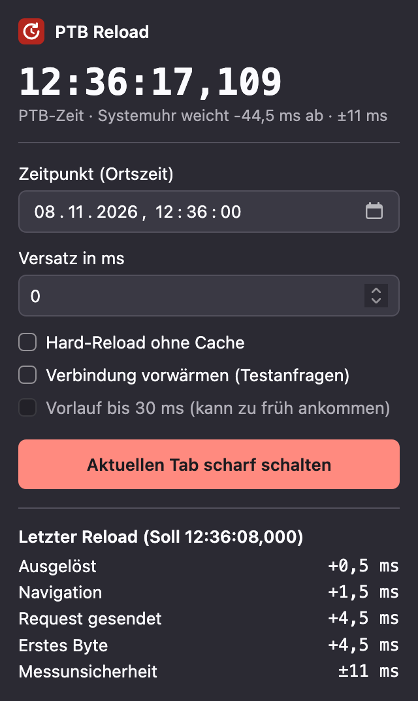

# PTB Reload

Firefox-Erweiterung, die einen Tab zu einem festgelegten Zeitpunkt neu lädt, zum Beispiel beim Start eines Ticket-Vorverkaufs. Die Zeit kommt direkt von der Uhr der Physikalisch-Technischen Bundesanstalt auf [uhr.ptb.de](https://uhr.ptb.de), die Systemuhr wird nur als Zwischenschritt genutzt.

## Installation

Du brauchst Firefox 142 oder neuer.

1. Die [aktuelle Version unter GitHub Releases](https://github.com/lukas-runge/ptb-reload/releases/latest) öffnen und unter **Assets** die Datei herunterladen, die auf `.xpi` endet.
2. Die `.xpi`-Datei in ein Firefox-Fenster ziehen.
3. Die Nachfrage mit **Hinzufügen** bestätigen.
4. Das Puzzle-Symbol in der Symbolleiste öffnen und PTB Reload über das Zahnrad anheften.

Die Erweiterung bleibt danach auch nach einem Neustart installiert. Das Repository ist privat. Wer keinen Zugriff darauf hat, braucht die `.xpi`-Datei direkt vom Projektinhaber.

Zum Testen klickst du auf das Symbol. Oben muss eine laufende Uhrzeit stehen. Bleibt dort `Verbinde mit uhr.ptb.de` stehen, blockiert meist eine Firewall oder ein Werbeblocker die Verbindung.

## Benutzung



1. Die Seite öffnen, die neu geladen werden soll.
2. Auf das Symbol von PTB Reload klicken.
3. Zeitpunkt eintragen und **Aktuellen Tab scharf schalten** wählen.
4. Tab und Fenster sichtbar lassen und den Computer nicht schlafen legen. Oben rechts auf der Seite läuft ein Countdown mit Abbrechen-Knopf, zum Beispiel `noch 3 Stunden 20 Minuten 5,4 Sekunden`. Das Popup zeigt ihn ebenfalls.

Nach dem Reload zeigt das Popup, wie weit Auslösung, Navigation, Request und erstes Byte vom Soll entfernt lagen. Liegt der Zeitpunkt mehr als 5 Sekunden zurück, zum Beispiel nach dem Ruhezustand, lädt die Erweiterung nicht mehr neu und meldet das.

Für einen Vorverkauf empfehle ich **Verbindung vorwärmen** an und **Vorlauf** aus. Kommt noch die alte Seite, einfach von Hand neu laden, denn die Erweiterung lädt pro Planung nur einmal.

### Checkliste vor dem Vorverkauf

- Den Computer wach halten. Auf macOS reicht `caffeinate -dimsu` in einem offenen Terminal, bei einem MacBook zusätzlich Netzteil anschließen und Deckel offen lassen. Unter Windows `powercfg /a` prüfen.
- Firefox nicht neu starten und Updates vorher erledigen oder pausieren. Der geplante Reload liegt nur im Speicher und ginge sonst verloren.
- Den Tab nicht schließen und nicht auf eine andere Seite wechseln.
- Am besten 10 bis 30 Minuten vorher scharf schalten. Dann ist die Seite frisch und der Login gültig.
- Einmal unter echten Bedingungen gegen den Testserver probieren (`npm run test-server`, siehe unten).

## Optionen

| Option | Wirkung | Empfehlung |
|---|---|---|
| Versatz in ms | Verschiebt den Zeitpunkt. Positive Werte lösen später aus. | Nach Bedarf, etwa `+200`, wenn die Server-Uhr nachgehen könnte |
| Hard-Reload | Lädt ohne Cache und öffnet dabei immer eine neue Verbindung. Vorwärmen ist dann deaktiviert. | Aus |
| Verbindung vorwärmen | Schickt zu einem zufälligen Zeitpunkt 3,5 bis 6 Sekunden vorher eine einzige Anfrage an die Seite, damit der Reload eine offene Verbindung nutzt. | An |
| Vorlauf bis 30 ms | Löst früher aus, um die geschätzte Laufzeit zum Server auszugleichen. | Aus |

Beim Vorlauf misst die Erweiterung die Laufzeit bevorzugt am Verbindungsaufbau, den Firefox beim Laden der Seite ohnehin protokolliert. Den beantworten Betriebssystem oder Load Balancer, deshalb ändert sich der Wert kaum, wenn der Shop kurz vor dem Start unter Last gerät. Fehlt dieser Wert, nimmt sie die schnellste von bis zu 3 Anfragen. Die Rechenzeit des Servers steckt dann mit drin, und der Reload kann bis zu 30 ms zu früh kommen. Eine zu frühe Anfrage bekommt die alte Seite, ein paar Millisekunden Verspätung schaden dagegen kaum.

### So unauffällig ist das Vorwärmen

- Es geht genau eine Anfrage raus, nur mit Vorlauf und ohne Messung des Verbindungsaufbaus bis zu 3.
- Es ist ein normales `GET` auf eine kleine statische Datei derselben Domain, die die Seite schon geladen hat, zum Beispiel CSS oder ein Bild. Gibt es keine, wird `/favicon.ico` angefragt. Firefox prüft dabei nur, ob sich die Datei geändert hat, und bekommt meist eine kurze `304`-Antwort.
- Der Zeitpunkt ist zufällig. Lädt sich die Seite zwischendurch selbst neu, entsteht keine zusätzliche Anfrage.
- Jede Anfrage gibt nach 1,5 Sekunden auf. Ein überlasteter Server kann den Reload deshalb nicht blockieren. Hängt die Anfrage bei HTTP/1.1 noch, nutzt der Reload eine neue Verbindung und ist dann so schnell wie ohne Vorwärmen.

Es bleibt ein echter Firefox mit echten Cookies. Tarnung wie gefälschte Header gibt es nicht. Auffälliger als jede Testanfrage ist ohnehin der Reload selbst, weil er auf wenige Millisekunden genau zur vollen Sekunde kommt.

## Genauigkeit

Gemessen mit Firefox 159 im Headless-Modus und einem lokalen Server. Die Netzlaufzeit hat ein Proxy simuliert, ohne HTTPS. Angegeben ist die Ankunft am Server relativ zum Soll. Jede Zeile umfasst 2 bis 10 Läufe. Die Zeilen mit Last stammen aus Version 1.2.0, ebenso eine Wiederholung der 40/40-Zeilen mit gleichem Ergebnis. Die Vorlauf-Zeile entspricht Version 1.2.0 ohne Messung des Verbindungsaufbaus. Hinter dem lokalen Proxy dauert dieser Aufbau nur etwa 1 ms, deshalb bleibt der Vorlauf dort sonst bei 0.

| Netz hin/zurück | Einstellung | Ankunft |
|---|---|---|
| lokal | Tab sichtbar | +3 bis +7 ms |
| 15/15 ms | ohne Vorwärmen | +52 bis +55 ms |
| 15/15 ms | Vorwärmen | +16 bis +19 ms |
| 40/40 ms | ohne Vorwärmen | etwa +126 bis +130 ms |
| 40/40 ms | Vorwärmen | +44 bis +47 ms |
| 40/40 ms | Vorwärmen und Vorlauf | +16 bis +19 ms |
| 40/40 ms, ab T−7 s jede Antwort 2 s langsamer | Vorwärmen | +43 bis +46 ms |
| 40/40 ms, ab T−7 s jede Antwort 8 s langsamer | Vorwärmen | +127 ms, wie ohne Vorwärmen |

Bei Last gibt die Testanfrage nach 1,5 s auf und der Vorlauf bleibt bei 0. Im letzten Fall hing die Testanfrage zum Reload noch auf der Verbindung, deshalb lief er über eine neue. Mit HTTP/2 oder HTTP/3, wie bei den meisten Shops, wäre das nicht passiert.

Den gemessenen Verbindungsaufbau habe ich gegen echte Server über HTTPS geprüft: Er lag 0 bis 5 ms über einem reinen TCP-Connect aus Node, zum Beispiel 233 statt 234 ms nach Brasilien und 27 statt 23 ms zur PTB. Bei HTTP/3 enthält der Verbindungsaufbau auch die Verschlüsselung, deshalb nutzt die Erweiterung ihn dort nicht.

Die absolute Genauigkeit gegenüber der PTB liegt bei etwa ±10 ms, weil Hin- und Rückweg zur PTB nie exakt gleich lang sind. Die größte Unbekannte bleibt die Uhr des Ticket-Servers. Sie kann deutlich stärker abweichen als alle Werte in dieser Tabelle.

Das Projekt gehört nicht zur PTB. Es nutzt den WebSocket `wss://uhr.ptb.de/time`, über den auch die PTB-Webuhr läuft. Der Endpunkt ist nicht offiziell dokumentiert und kann sich ändern.

## Datenschutz und Berechtigungen

Die Erweiterung erhebt keine Daten und hat kein eigenes Backend. An uhr.ptb.de gehen nur Zeitstempel. Mit aktivem Vorwärmen geht die oben beschriebene Anfrage an die geöffnete Seite, einschließlich ihrer Cookies.

`tabs` braucht sie, um den Tab neu zu laden und seinen Zustand zu verfolgen. `<all_urls>` braucht sie, um den Countdown in die gewählte Seite einzufügen und danach die Ladezeiten auszulesen.

Automatisches Neuladen kann gegen die AGB eines Shops verstoßen. Die Erweiterung löst pro Planung genau einen Reload aus.

## Entwicklung

```bash
npm ci
npm run lint          # web-ext lint, Warnungen zählen als Fehler
npm test              # Unit-Tests
npm run build         # ZIP in web-ext-artifacts/
npm run dev           # Firefox mit geladener Erweiterung starten
npm run test:smoke    # echter Reload-Test, braucht geckodriver
npm run test-server   # loggt jede Anfrage in PTB-Zeit
```

Der Testserver läuft auf `http://127.0.0.1:8123/`. Er zeigt für jede Anfrage die Abweichung zur nächsten vollen Sekunde, damit sich ein geplanter Reload direkt prüfen lässt.

`extension/` enthält nur das, was im Paket landet:

- `background.js` misst die PTB-Zeit und verwaltet den geplanten Reload.
- `trigger.js` läuft im Ziel-Tab, wärmt die Verbindung vor, zählt die letzten Millisekunden aktiv ab und löst aus.
- `countdown.js` formatiert die Restzeit für Seite und Popup.
- `popup.*` ist die Oberfläche.

## Release und Signierung

Normales Firefox installiert dauerhaft nur von Mozilla signierte Erweiterungen. Für die Signierung ohne öffentlichen Eintrag im Add-on-Katalog:

1. Unter [addons.mozilla.org/developers/addon/api/key](https://addons.mozilla.org/developers/addon/api/key/) einen API-Schlüssel erzeugen.
2. Beide Werte als Repository-Secrets speichern:

   ```bash
   gh secret set AMO_JWT_ISSUER
   gh secret set AMO_JWT_SECRET
   ```

3. `version` in `extension/manifest.json` erhöhen, committen und den passenden Tag pushen:

   ```bash
   git tag v1.2.0
   git push origin v1.2.0
   ```

Der Workflow baut das ZIP, signiert bei vorhandenen Secrets eine `.xpi` und hängt beides an ein GitHub-Release. Ohne Secrets enthält das Release nur das unsignierte ZIP.
